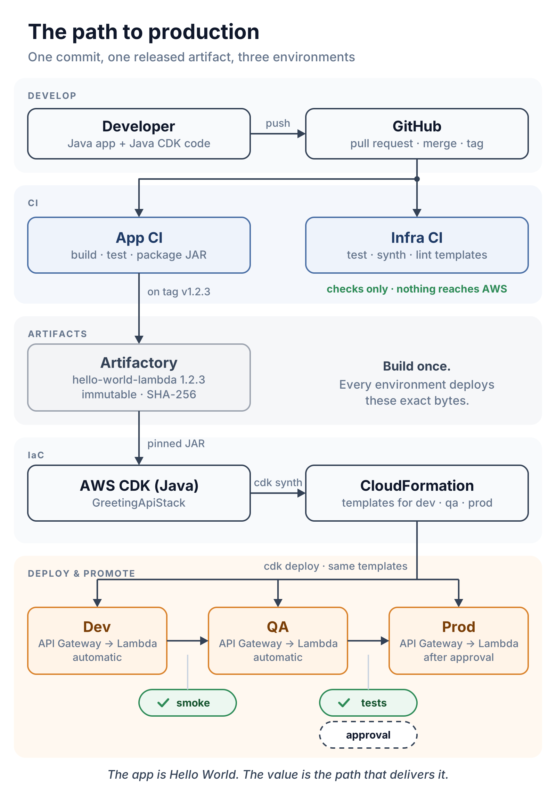
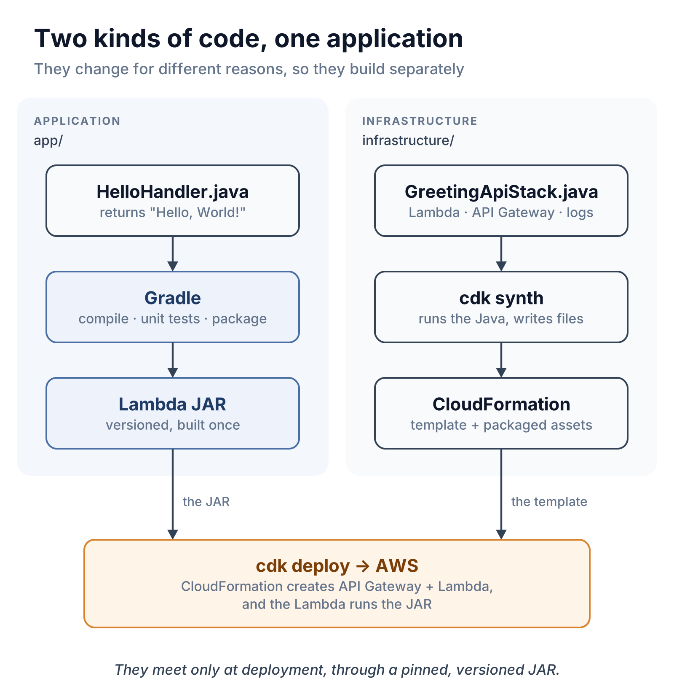
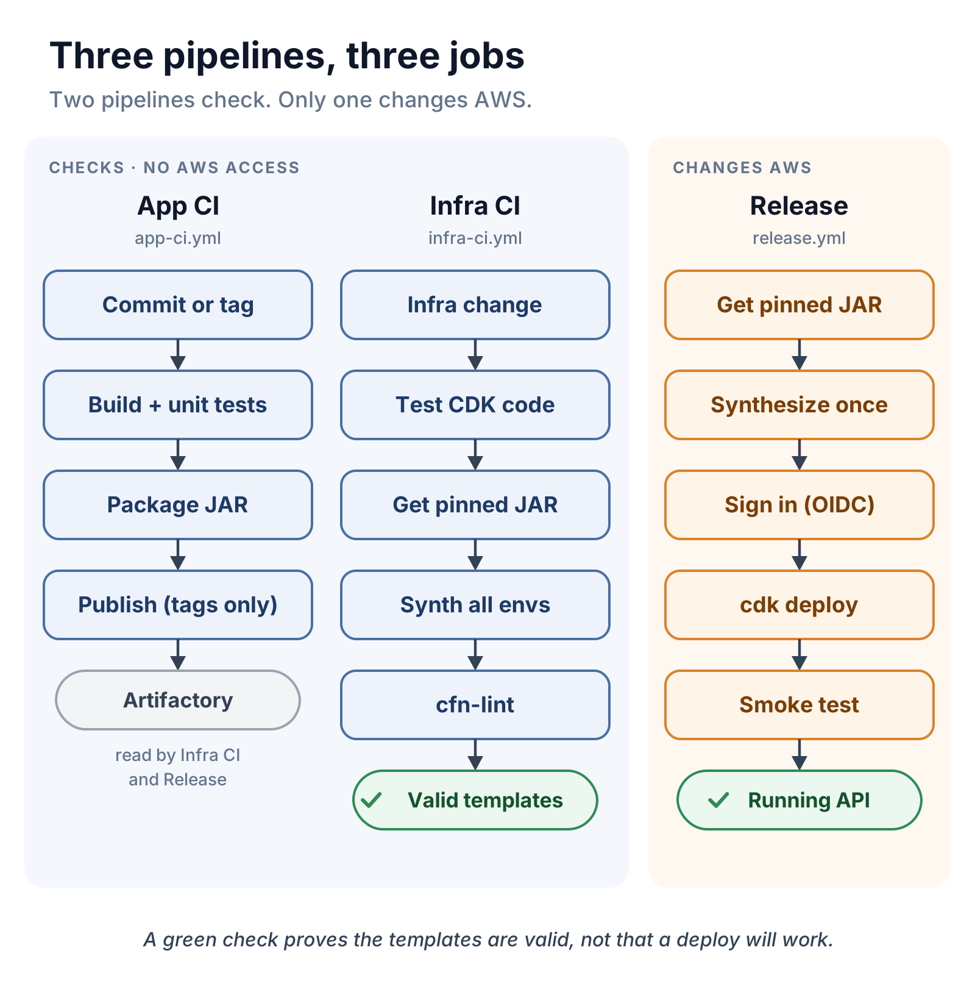

# AWS CDK: the path to production

[](https://github.com/riteshbangal/aws-cdk-path-to-production/actions/workflows/app-ci.yml)
[](https://github.com/riteshbangal/aws-cdk-path-to-production/actions/workflows/infra-ci.yml)

The path from commit to production for a serverless app on AWS: versioned artifacts, AWS CDK infrastructure in Java, GitHub Actions with OIDC, and gated Dev → QA → Prod promotion.

The app is deliberately a Hello World, so the delivery path stays the focus.

<p align="center">
  
</p>

## What's in here

```text
app/                    The payload: a Java 21 Lambda that returns "Hello, World!"
infrastructure/         AWS CDK in Java: API Gateway + Lambda, with unit tests
  lambda-artifact.env   The release pin: which JAR version (and SHA-256) to deploy
foundation/             One-time AWS setup: the role GitHub Actions signs in to (OIDC)
scripts/                Fetch/publish the JAR, synth + lint, smoke and QA checks
.github/workflows/      app-ci · infra-ci · release (+ reusable deploy-environment)
docs/                   The reasoning behind each piece, and the diagrams
```

This is a serverless architecture: API Gateway and Lambda, deployed with CloudFormation. No Kubernetes, containers or Helm.

## The ideas, in five more pictures

**Two kinds of code.** The application and its infrastructure change for different reasons, so they build separately and meet only at deployment.
<p align="center"></p>

**Three pipelines.** Two of them only check. Only the release pipeline changes AWS.
<p align="center"></p>

**Bootstrap first.** `cdk bootstrap` prepares the deployment machinery once per account and region. `cdk deploy` builds the application on top of it.
<p align="center"></p>

**No stored AWS keys.** GitHub vouches for the job with a signed token; AWS trades it for credentials that expire within an hour.
<p align="center"></p>

**Promotion through gates.** The same JAR and the same templates move from Dev to QA to Prod. Each environment has to pass its checks before the next one gets the release.
<p align="center"></p>

## What's verified, and what isn't

| | Status |
|---|---|
| App build and unit tests | Run by **App CI** on every change (badge above) |
| CDK unit tests, synthesis of dev/qa/prod, `cfn-lint` | Run by **Infra CI** on every change (badge above) |
| Publishing to Artifactory, deploying to AWS, smoke and QA tests | Written and linted, but they run only after **you** connect an artifact repository and AWS accounts. This repository does not claim a deployment has run. |

A green Infra CI run means the templates are valid. It does not prove a deployment will succeed.

## Run it yourself

### Level 1: locally, no AWS account needed

You need Java 21 and Node.js (CDK for Java runs on Node.js under the hood).

```bash
# Build and test the application
cd app && ./gradlew build

# Give the infrastructure a JAR to package (in CI this comes from Artifactory)
mkdir -p ../infrastructure/artifacts
cp build/libs/hello-world-lambda.jar ../infrastructure/artifacts/

# Test the infrastructure and synthesize a template. Nothing touches AWS.
cd ../infrastructure && ./gradlew test
npx aws-cdk@2.1145.0 synth GreetingApiDevStack
```

### Level 2: connect your own AWS accounts

1. **Bootstrap** each target account and region once: `npx aws-cdk@2.1145.0 bootstrap aws://<ACCOUNT_ID>/eu-west-1` ([docs/03](docs/03-cdk-bootstrap.md)).
2. **Create the deploy role** for each environment from [`foundation/github-oidc-deploy-role.yaml`](foundation/github-oidc-deploy-role.yaml) ([docs/02](docs/02-aws-authentication-oidc.md)).
3. **Create GitHub environments** `dev`, `qa` and `production`. In each, set the variable `AWS_DEPLOY_ROLE_ARN` (and optionally `AWS_REGION`), and allow deployments from `main` only. On `production`, add required reviewers: that is the approval gate.
4. **Connect an artifact repository**: the repository variable `ARTIFACTORY_BASE_URL` and the secrets `ARTIFACTORY_PUBLISH_TOKEN` and `ARTIFACTORY_READ_TOKEN`.
5. **Release the app**: push the tag `v1.0.0`. App CI publishes the JAR and prints its SHA-256.
6. **Pin it**: put that version and SHA-256 in [`infrastructure/lambda-artifact.env`](infrastructure/lambda-artifact.env) through a pull request.
7. **Promote**: run the **Release** workflow by hand, or set the repository variable `DEPLOYMENTS_ENABLED=true` so that merges to `main` release automatically.

[docs/06](docs/06-release-promotion.md) walks through the release flow and the rollback steps.

## Before you call it production

This is a reference path, not a hardened service. Before real traffic, add at least:

- API authorization (IAM, Cognito or a Lambda authorizer), WAF and throttling.
- CloudWatch alarms on errors and latency, wired to the production gate.
- A scoped CloudFormation execution policy instead of the bootstrap default.
- Separate AWS accounts for dev, qa and prod.
- Actions pinned to commit SHAs, plus dependency updates (e.g. Dependabot).
- A rollback runbook that someone has actually rehearsed.

## Docs

1. [End to end](docs/01-end-to-end.md): the whole flow and who does what
2. [AWS authentication with OIDC](docs/02-aws-authentication-oidc.md)
3. [CDK bootstrap](docs/03-cdk-bootstrap.md)
4. [Implementation walkthrough](docs/04-implementation-walkthrough.md): the files and the decisions behind them
5. [Platform and runner options](docs/05-platform-and-runner-options.md): Jenkins, self-hosted runners, CodePipeline
6. [Release promotion and smoke tests](docs/06-release-promotion.md)

Diagrams are generated by [`docs/diagrams/generate.py`](docs/diagrams/generate.py).

## License

[MIT](LICENSE)
