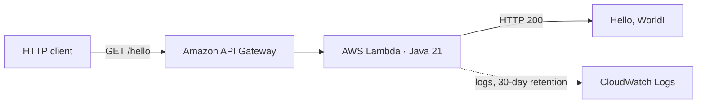

# 01 · End to end: the whole path in one page

> A serverless **Greeting API** (API Gateway → Lambda, Java 21), delivered the way a mature team would deliver a real service. **Not Kubernetes**: no EKS, Helm, Argo CD or containers.
>
> **Status:** the build, test, synth and lint stages run in GitHub Actions on every change. The publish, deploy and promotion stages are implemented but only run once you connect an artifact repository and AWS accounts. Nothing here claims a deployment has run.

## What gets deployed



| Name | What it is |
|---|---|
| `GreetingApiStack` | The Java CDK class that defines the stack |
| `GreetingApiDevStack`, `GreetingApiQaStack`, `GreetingApiProdStack` | The deployed CloudFormation stacks |
| `HelloLambda` | The Lambda construct |
| `/hello` | The only route; the API Gateway stage is named after the environment |

## The whole flow


1. A developer pushes Java app code and Java CDK code to GitHub.
2. **App CI** builds, tests and packages the JAR. On a tag such as `v1.2.3` it publishes that exact JAR, once, to Artifactory.
3. A pull request pins the release in `infrastructure/lambda-artifact.env`: the version plus its SHA-256.
4. **Infra CI** tests the CDK code, synthesizes templates for all three environments and lints them. It never touches AWS.
5. The **Release** workflow fetches the pinned JAR, verifies its digest, synthesizes the templates **once**, then deploys those same files to Dev, then QA, then Prod, with a gate before each step.

## Who does what

| Part | Responsibility |
|---|---|
| GitHub | Source of truth, pull requests, environments and approvals |
| Gradle (Kotlin DSL) | Compile, test and package the Java code (two independent builds) |
| GitHub Actions | Run the three pipelines |
| Artifactory | Store each released JAR, immutably, by version |
| AWS CDK (Java) | Describe the infrastructure as code (`GreetingApiStack`) |
| CDK CLI | `cdk synth` writes templates; `cdk deploy` hands them to CloudFormation |
| CloudFormation | Create or update the AWS resources |
| API Gateway + Lambda | Run the application |
| Smoke and QA tests | Check each deployment before the next environment gets it |

## Three pipelines, three jobs


| Workflow | Runs on | Touches AWS? |
|---|---|---|
| [`app-ci.yml`](../.github/workflows/app-ci.yml) | Changes under `app/`; tags `v*.*.*` publish | No |
| [`infra-ci.yml`](../.github/workflows/infra-ci.yml) | Changes under `infrastructure/`, `foundation/`, `scripts/` | No |
| [`release.yml`](../.github/workflows/release.yml) | Manual, or on infrastructure changes once `DEPLOYMENTS_ENABLED=true` | **Yes**, through [`deploy-environment.yml`](../.github/workflows/deploy-environment.yml) |

## Commands and where they run

```bash
# Build the application: laptop or CI runner, no AWS needed
cd app && ./gradlew build

# Synthesize a template: writes files only, deploys nothing
cd infrastructure && npx aws-cdk@2.1145.0 synth GreetingApiDevStack

# Deploy: only from an authorized identity, after bootstrap
cdk deploy GreetingApiDevStack --app cdk.out/dev --require-approval never
```

## Quick answers

| Question | Answer |
|---|---|
| Is this Kubernetes? | **No.** Lambda and API Gateway, deployed by CloudFormation. |
| Do I need AWS to build the JAR? | **No.** Only deployment needs AWS. |
| Does uploading an artifact in GitHub Actions send it to AWS? | **No.** GitHub artifact storage is just storage on GitHub. |
| Does a clean `cdk synth` prove a deploy will work? | **No.** It proves the templates are well-formed. |
| Why bootstrap? | CDK needs a bucket and roles in each account and region before its first deploy ([03](03-cdk-bootstrap.md)). |
| Is a self-hosted runner an alternative to OIDC? | **No.** Where a job runs and how it authenticates are separate choices ([05](05-platform-and-runner-options.md)). |
| When does Prod get a release? | After Dev and QA pass their gates and a reviewer approves ([06](06-release-promotion.md)). |
