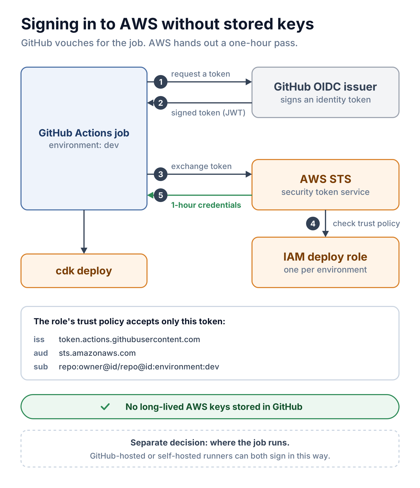

# 02 · GitHub Actions → AWS: OIDC, IAM and STS

> **Core idea:** no AWS keys live in GitHub. Each deploy job proves who it is with a short-lived token from GitHub, and AWS trades that token for credentials that expire within an hour.



## The pieces

| Piece | Question it answers |
|---|---|
| GitHub OIDC issuer (`iss`) | Who signed the token? `https://token.actions.githubusercontent.com` |
| Audience (`aud`) | Who is the token for? `sts.amazonaws.com` |
| Subject (`sub`) | Which repository and environment is asking? |
| IAM role **trust policy** | Which tokens may assume this role? |
| IAM role **permissions** | What may the role do once assumed? |
| AWS STS | Issues temporary credentials, never permanent keys |

There is no OIDC server to run: GitHub already operates the issuer, and AWS already operates IAM and STS.

## The subject claim for this repository

Repositories created after 15 July 2026 use **immutable subject claims**, which include the owner and repository IDs. This repository was created after that date, so a job in the `dev` environment presents:

```text
repo:riteshbangal@29270996/aws-cdk-path-to-production@1422459044:environment:dev
```

For your own repository or fork, build the repository part with the GitHub CLI:

```bash
gh api repos/OWNER/REPO --jq '"repo:\(.owner.login)@\(.owner.id)/\(.name)@\(.id)"'
```

Older repositories use `repo:OWNER/REPO` unless they opted in. Don't mix the two styles. To see the exact claims, run the **Show OIDC claims** workflow ([`show-oidc-claims.yml`](../.github/workflows/show-oidc-claims.yml)). It prints `iss`, `aud` and `sub` for the environment you choose, never the token itself.

## Set it up (once per AWS account and environment)

[`foundation/github-oidc-deploy-role.yaml`](../foundation/github-oidc-deploy-role.yaml) creates the identity provider and one deploy role. Bootstrap the account first ([03](03-cdk-bootstrap.md)).

```bash
aws cloudformation deploy \
  --stack-name aws-cdk-path-to-production-dev-github-oidc \
  --template-file foundation/github-oidc-deploy-role.yaml \
  --capabilities CAPABILITY_NAMED_IAM \
  --parameter-overrides \
      GitHubRepoClaim=repo:riteshbangal@29270996/aws-cdk-path-to-production@1422459044 \
      GitHubEnvironment=dev
```

- An AWS account can hold only **one** provider for `token.actions.githubusercontent.com`. If dev, qa and prod share an account, or the provider already exists, pass `CreateOidcProvider=false` for the second and later stacks.
- Copy the stack output `DeployRoleArn` into the matching GitHub environment as the variable `AWS_DEPLOY_ROLE_ARN`. A role ARN is not a secret.

### What the role trusts, and what it may do

```yaml
# Trust: only GitHub-issued tokens, for STS, from this repository AND environment
token.actions.githubusercontent.com:aud: sts.amazonaws.com
token.actions.githubusercontent.com:sub: <GitHubRepoClaim>:environment:<GitHubEnvironment>

# Permissions: only hand the work to the roles `cdk bootstrap` created
sts:AssumeRole  →  cdk-hnb659fds-{deploy,file-publishing,lookup}-role-<account>-<region>
```

The GitHub role cannot create a Lambda function, or anything else, by itself. CDK's bootstrap roles do the actual work, which keeps this role very small. Never trust `sub: *` or a whole organization.

## The workflow side

The reusable [`deploy-environment.yml`](../.github/workflows/deploy-environment.yml) does three things:

```yaml
permissions:
  id-token: write          # allow this job to request a GitHub OIDC token
environment: dev           # becomes part of the token's sub claim
- uses: aws-actions/configure-aws-credentials@v6
  with:
    role-to-assume: ${{ vars.AWS_DEPLOY_ROLE_ARN }}   # set per GitHub environment
```

Because each GitHub environment holds its own `AWS_DEPLOY_ROLE_ARN`, the same workflow signs in to the dev account as the dev role and to the prod account as the prod role. A dev job can't present a token that the prod role trusts.

## OIDC vs access keys in GitHub Secrets

| | OIDC + IAM role (this repo) | Access keys in GitHub Secrets |
|---|---|---|
| Credential | Temporary STS session, at most 1 hour | Long-lived IAM key pair |
| Rotation | Automatic | Your job |
| Scope | Repository + environment, enforced by AWS | Whoever can use the secret |
| Setup | One CloudFormation stack | Quicker for a throwaway demo |

If you must use keys for a short-lived experiment, use a dedicated non-root IAM user with least privilege, then delete the keys afterwards. Swap the `role-to-assume` input for `aws-access-key-id` and `aws-secret-access-key`, and drop `id-token: write`.

## Runner choice is a separate decision

GitHub-hosted runners and self-hosted runners (for example on EC2) can both use OIDC. A self-hosted EC2 runner can also use its instance profile, but those credentials belong to the **machine**, not to a specific workflow, which changes the security boundary. See [05](05-platform-and-runner-options.md).

## Checklist

- [ ] Trust policy matches the exact `sub` (owner and repository IDs, plus environment)
- [ ] GitHub environments allow deployments from `main` only
- [ ] No wildcard trust; no `AdministratorAccess` on the GitHub role
- [ ] Separate AWS accounts for dev, qa and prod where practical
- [ ] CloudTrail enabled, so every `AssumeRoleWithWebIdentity` is auditable

## Sources

- [GitHub: OpenID Connect reference](https://docs.github.com/en/actions/reference/security/oidc)
- [GitHub changelog: immutable subject claims](https://github.blog/changelog/2026-04-23-immutable-subject-claims-for-github-actions-oidc-tokens/)
- [AWS: creating a role for OIDC federation](https://docs.aws.amazon.com/IAM/latest/UserGuide/id_roles_create_for-idp_oidc.html)
