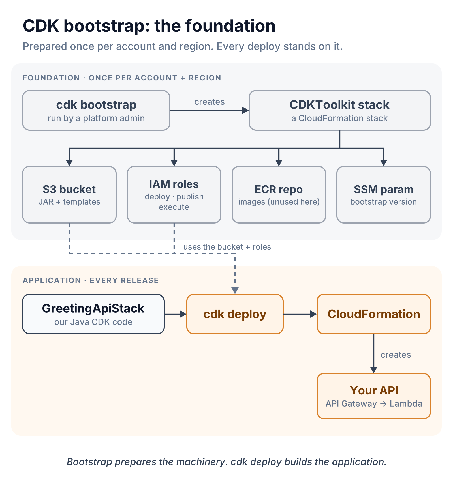
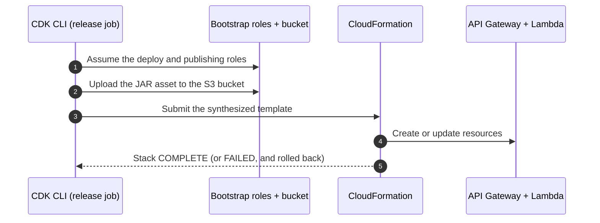

# 03 · CDK bootstrap: the foundation under every deploy

> **Core idea:** two layers of infrastructure as code. `cdk bootstrap` prepares the **deployment machinery** once per account and region. `GreetingApiStack` creates the **application** on every release.



## Why bootstrap if CDK is already infrastructure as code?

`cdk deploy` has to upload the Lambda JAR somewhere and needs permission to ask CloudFormation for changes. Bootstrapping creates that bucket and those roles, using a standard CloudFormation template that ships with CDK. You don't write any bootstrap code yourself.

## What's inside the `CDKToolkit` stack

| Resource | Why it exists |
|---|---|
| S3 bucket | Holds the JAR and templates during deployment |
| ECR repository | Holds container image assets (not used here: this Lambda ships as a JAR) |
| File and image publishing roles | Upload assets during `cdk deploy` |
| Deploy role | Lets the CDK CLI start stack deployments |
| CloudFormation execution role | What CloudFormation itself uses to create resources |
| Lookup role | Read-only lookups of existing AWS resources |
| SSM parameter | The bootstrap version CDK expects |

## Run it once per account and region

From an authorized identity, such as CloudShell or the platform team's automation. Never use root credentials.

```bash
aws sts get-caller-identity                          # 1. am I in the right account?
npx aws-cdk@2.1145.0 bootstrap aws://<ACCOUNT_ID>/eu-west-1   # 2. bootstrap

aws cloudformation describe-stacks --stack-name CDKToolkit \
  --region eu-west-1 --query 'Stacks[0].StackStatus' --output text   # 3. expect CREATE_COMPLETE
```

With separate dev, qa and prod accounts, bootstrap each one. Then apply this repository's second foundation piece, the GitHub deploy role ([02](02-aws-authentication-oidc.md)).

## What `cdk deploy` does with it



`cdk synth` runs the Java CDK code and writes the template; it creates nothing in AWS. `cdk deploy` uploads assets, hands the template to CloudFormation, and waits until the stack update finishes.

## Foundation vs application

| | Foundation | Application |
|---|---|---|
| Defined by | CDK's standard template + `foundation/github-oidc-deploy-role.yaml` | `GreetingApiStack.java` |
| Stack | `CDKToolkit`, plus one deploy-role stack per environment | `GreetingApi{Dev,Qa,Prod}Stack` |
| How often | Once, then occasional upgrades | Every release |
| Typical owner | Cloud platform team | Application team |

## Traps to avoid

- **Bootstrap is not a deployment.** A `CDKToolkit` stack doesn't mean the API exists.
- **Tighten the execution role before production.** By default the CloudFormation execution role has broad permissions. Pass a scoped policy with `--cloudformation-execution-policies`.
- **Don't add cross-account `--trust` casually.** Trust plus execution rights is a powerful combination.
- **It isn't free.** Staged assets cost a little S3 storage.

## Sources

- [AWS CDK: bootstrapping](https://docs.aws.amazon.com/cdk/v2/guide/bootstrapping-env.html)
- [AWS CDK: `cdk bootstrap` reference](https://docs.aws.amazon.com/cdk/v2/guide/ref-cli-cmd-bootstrap.html)
- [AWS CDK: how deployment works](https://docs.aws.amazon.com/cdk/v2/guide/deploy.html)
