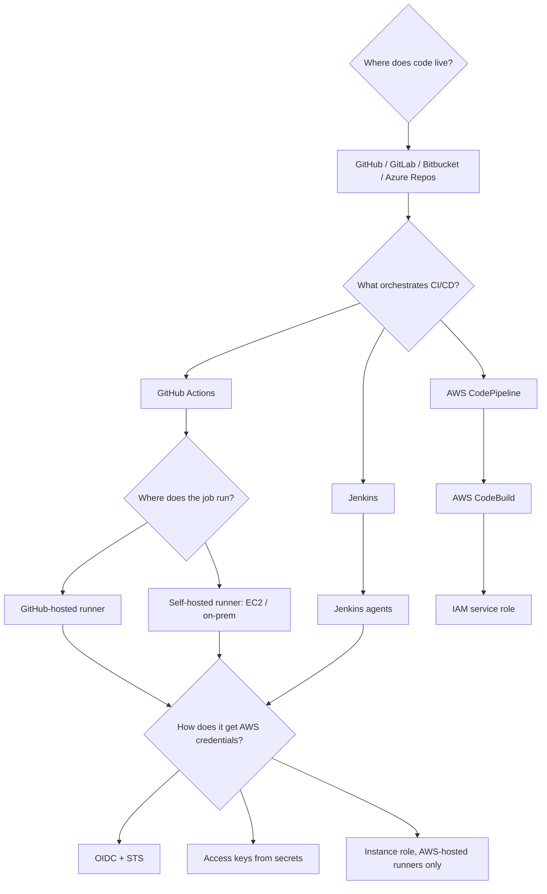
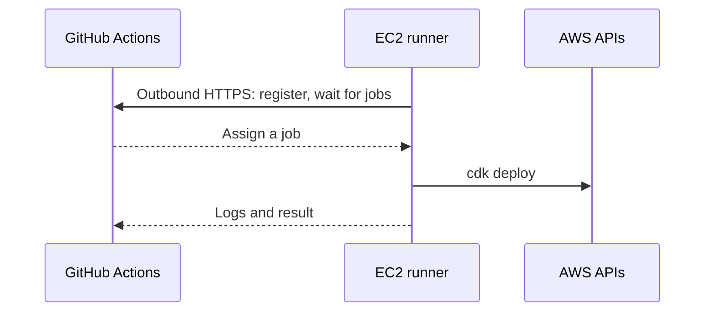
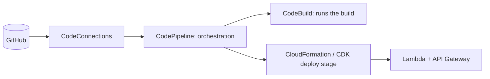

# 05 · Platform choices: Actions, Jenkins, runners and AWS-native CI/CD

> **Core idea:** don't mix up four separate decisions: where the **code** lives, what **orchestrates** the pipeline, where the **job runs**, and how the job **authenticates** to AWS.

## Four separate questions



**A runner is an execution location, not an identity protocol.** A GitHub-hosted runner can use OIDC or secrets. An EC2 self-hosted runner can use OIDC or its instance profile.

## What organizations usually standardize

| Concern | Common options | Usually decided by |
|---|---|---|
| Source control | GitHub, GitLab, Bitbucket, Azure Repos | Organization |
| CI orchestration | GitHub Actions, Jenkins, GitLab CI, Azure Pipelines | Platform / DevOps |
| Java build | Gradle, Maven | App teams, within standards |
| Infrastructure as code | AWS CDK, Terraform, CloudFormation | Cloud platform |
| Artifact repository | JFrog Artifactory, Nexus, GitHub Packages, S3 | Platform |
| Runtime | Lambda, ECS, EKS | Architecture |
| Monitoring | CloudWatch, Prometheus/Grafana, Datadog | Platform / SRE |

## GitHub Actions vs Jenkins

| | GitHub Actions (this repo) | Jenkins |
|---|---|---|
| With GitHub | Native | Plugins and webhooks |
| Control plane | Run by GitHub | Run by your organization |
| Jobs execute on | Hosted or self-hosted runners | Jenkins agents |
| Pipeline file | `.github/workflows/*.yml` | `Jenkinsfile` |

The build logic barely changes between them, because the real work lives in Gradle and in `scripts/`:

```groovy
// Jenkinsfile outline: an alternative to the workflows, not something to run alongside them
pipeline {
  agent any   // needs Java 21, Node.js, the CDK CLI and cfn-lint
  stages {
    stage('App')   { steps { sh 'cd app && ./gradlew build' } }
    stage('Infra') { steps { sh 'cd infrastructure && ./gradlew test' } }
    stage('Synth') { steps { sh 'scripts/fetch-lambda-artifact.sh && scripts/synth-assemblies.sh' } }
  }
}
```

## Self-hosted runner on EC2

GitHub still orchestrates; an EC2 machine you manage runs the commands. The runner makes **outbound** HTTPS calls to GitHub, so no inbound access is needed.



- **Why:** private VPC access, custom toolchains, network policy.
- **Cost:** you own patching, isolation, scaling and secret exposure. Prefer ephemeral runners, minimal IAM, and never run untrusted fork pull requests on a privileged persistent runner.
- **Credentials:** the instance profile is **machine** trust, so any job on that box may use it. OIDC still works on self-hosted runners and keeps trust tied to the repository and environment.

## AWS CodePipeline + CodeBuild



CodePipeline plays the role of the orchestrator and CodeBuild plays the runner. AWS service roles grant the AWS permissions, while the GitHub connection needs its own authorization. It's a good fit when an organization already standardizes on AWS-native delivery.

## The choices in this repository

| Question | Decision |
|---|---|
| Source control | GitHub |
| Orchestrator | GitHub Actions |
| Runner | GitHub-hosted Ubuntu |
| AWS authentication | **OIDC → STS → one IAM role per environment** |
| Artifact repository | JFrog Artifactory (any server that accepts HTTP PUT/GET works) |
| Alternatives | Jenkins (outline above), CodePipeline + CodeBuild |

## Sources

- [GitHub: self-hosted runners](https://docs.github.com/en/actions/how-tos/manage-runners/self-hosted-runners/add-runners)
- [AWS CodePipeline concepts](https://docs.aws.amazon.com/codepipeline/latest/userguide/concepts.html)
- [AWS CodeBuild user guide](https://docs.aws.amazon.com/codebuild/latest/userguide/welcome.html)
