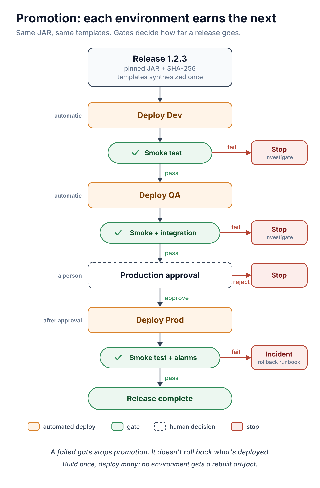
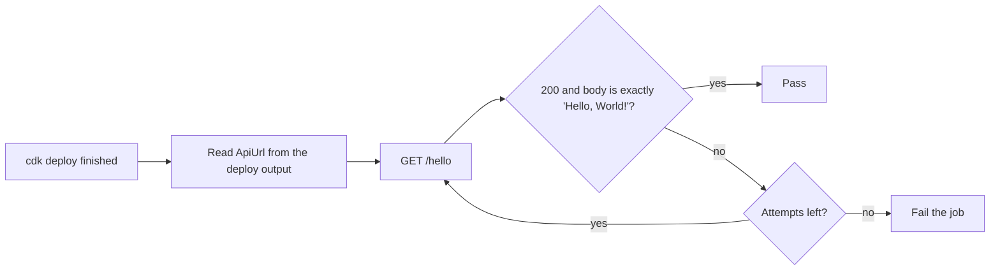

# 06 · Dev → QA → Production: promotion, smoke tests and rollback

> **Core idea:** build once, deploy many. One pinned JAR and one set of synthesized templates travel through every environment, and each environment has to pass its gate before the next one gets the release.
>
> **Status:** [`release.yml`](../.github/workflows/release.yml) implements this flow. It runs once you connect AWS; this repository doesn't claim it has.

## A release, step by step

1. **Tag** `v1.2.3`. App CI publishes the JAR and prints its SHA-256 in the run summary.
2. **Pin** it: a pull request updates [`infrastructure/lambda-artifact.env`](../infrastructure/lambda-artifact.env). Infra CI checks the change.
3. **Merge.** If `DEPLOYMENTS_ENABLED=true`, the Release workflow starts. Otherwise start it by hand and choose how far to promote: `dev`, `qa` or `production`.
4. **Synthesize once:** fetch the JAR, verify the digest, write `cdk.out/{dev,qa,prod}`, lint them.
5. **Dev:** deploy, then smoke test.
6. **QA:** deploy, smoke test, then the QA integration checks.
7. **Production:** the job waits for a reviewer, then deploys and smoke-tests.

Only one release runs at a time, and a running release is never cancelled halfway.

## Set up the gates

| Environment | Settings → Environments |
|---|---|
| `dev`, `qa` | Variable `AWS_DEPLOY_ROLE_ARN`; deployment branches: `main` only |
| `production` | The same, plus **required reviewers** |

On GitHub Free, Pro and Team, required reviewers only work on **public** repositories. This repository is public, so the gate works. A private copy needs GitHub Enterprise, or another approval mechanism.

## Smoke tests: what and when

`cdk deploy` waits for CloudFormation to finish, so there is **no fixed sleep** before testing. A fresh deployment can still take a moment to answer, so [`smoke-test.sh`](../scripts/smoke-test.sh) retries a bounded number of times:

The QA gate ([`integration-test.sh`](../scripts/integration-test.sh)) also checks the content type, that only `GET` is exposed, and that unknown paths are rejected. It is small, but it runs real checks, never a placeholder `echo`.

## What a failure does, and doesn't do

- A **failed deployment** (CloudFormation error) is rolled back by CloudFormation automatically.
- A **failed smoke or QA test** fails the job and **stops promotion**. It does **not** undo a deployment that CloudFormation already completed. That environment keeps running the new version until you act.

### Rollback runbook

1. **Fastest:** re-run the last good Release run in GitHub Actions. It redeploys from the same commit and the same pinned JAR.
2. **Proper fix:** revert the pin in `lambda-artifact.env` (or revert the infrastructure change) in a pull request and let the release pipeline promote it.
3. **Afterwards:** record what the gate missed, and add a check for it.

Rehearse this in dev before you need it in production.

## Never promote `latest`

The pin holds an exact version **and** a digest. "Latest" can change between dev and prod; a digest cannot.

## Which check proves what

| Check | Where | Proves | Doesn't prove |
|---|---|---|---|
| Compile + unit tests | App CI | The handler returns the right response | That AWS wiring works |
| CDK unit tests | Infra CI | The template has the intended resources | That AWS will accept it |
| `cdk synth` + `cfn-lint` | Infra CI, Release | Templates are well-formed | That a deploy will succeed |
| `cdk deploy` | Release | CloudFormation applied the stack | That the API answers |
| Smoke test | After each deploy | The critical path works right now | Full behaviour |
| QA integration checks | QA | The API's contract | Load, security, edge cases |
| Alarms | Production | Errors and latency get noticed | Anything, unless someone acts on them |

## Production readiness checklist

- [ ] Branch protection on `main`; Infra CI is a required check
- [ ] Artifactory forbids overwriting released versions
- [ ] One IAM role per environment via OIDC; separate AWS accounts
- [ ] Production reviewers configured and tested
- [ ] API authorization, WAF and throttling in place
- [ ] Alarms on errors and latency
- [ ] Scoped CloudFormation execution policy instead of the bootstrap default
- [ ] Rollback runbook rehearsed
- [ ] Traceability: Git commit → JAR version + SHA-256 → cloud assembly → CloudFormation stack

## Sources

- [GitHub: deployments and environments](https://docs.github.com/en/actions/reference/workflows-and-actions/deployments-and-environments)
- [AWS CDK: deployment lifecycle](https://docs.aws.amazon.com/cdk/v2/guide/deploy.html)
